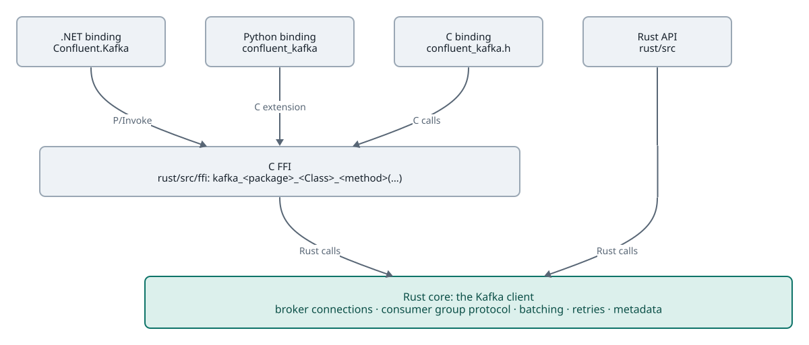
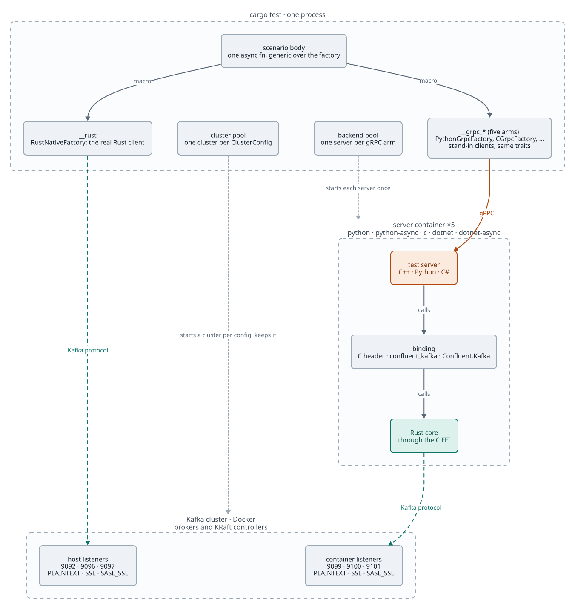
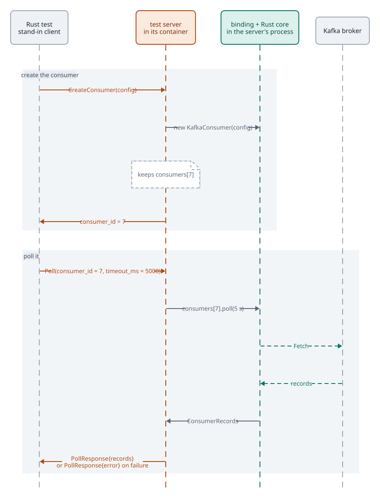
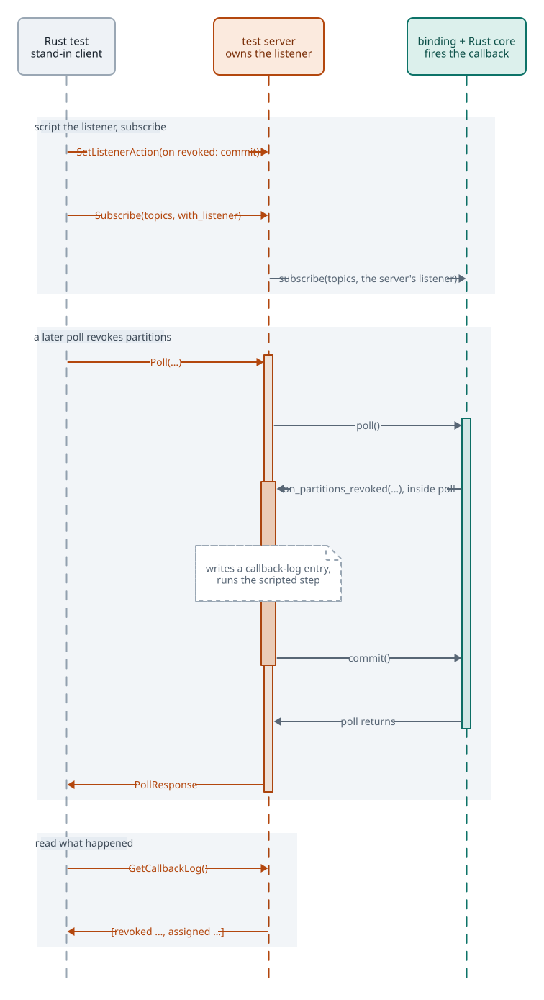

# Multilanguage test harness

Each broker scenario is written once, in Rust, and runs against every client in
the repository: the Rust client itself and the C, Python and .NET bindings. This
document explains how the harness is put together, how one test runs from start
to end, and how to write, run and debug a scenario.

Paths are relative to the repository root.

## Why one scenario runs on every client

There is one Kafka client: the Rust core, translated from Java. The C FFI wraps
it as plain C functions, and the Python and .NET bindings are thin layers on that
C interface (Python through its C extension `_confluentkafka`, .NET through
P/Invoke). A Python or .NET call ends in the same Rust code as a Rust call, and
only the core opens connections to the broker.



*The three bindings go through the C FFI and the Rust API calls the core
directly, but every call ends in the same Rust core.*

Most scenarios are translations of Java's own broker tests, such as
`PlaintextConsumerPollTest`. Running each translation once per client holds every
binding to the same Java behaviour, with the same assertions. A bug in the core
shows on every arm; a bug in a binding shows only on that binding's arms.

## The big picture

Three things run during a test: the `cargo test` process with the scenarios, a
Kafka cluster in Docker, and one test server per binding. The test process starts
the cluster and the servers the first time a test needs them, and shares them
with every later test.



*Each scenario becomes six tests. `__rust` uses the real Rust client in the test
process; the five `__grpc_*` arms forward every call to a test server, which runs
the real binding on the same Rust core.*

The colours mean the same in every diagram on this page: orange is a gRPC call,
teal dashed the Kafka protocol, grey solid a call inside one process, and grey
dotted a pool starting a container on first use.

The six arms are `__rust`, `__grpc_python`, `__grpc_python_async`, `__grpc_c`,
`__grpc_dotnet` and `__grpc_dotnet_async`. On macOS the test servers run as host
processes instead of containers (see [Running the tests](#running-the-tests)).

## The parts

| Part | Job | Where |
|---|---|---|
| Scenario | One async function, generic over a factory, usually the translation of one Java test method. | `async fn x<F: ConsumerBackendFactory>(ctx, factory)` in `rust/tests/integration/` |
| Macro | Expands a scenario into six `#[tokio::test(flavor = "multi_thread")]` arms. Built without the `multilanguage-tests` feature, it generates `__rust` only, so a scenario keeps its Rust coverage at every feature level. | `multilanguage_test!`, `multilanguage_consumer_test!`, `multilanguage_admin_test!` |
| Factory | Creates the arm's producer, consumer or admin client. It also says whether the client needs the broker's container addresses (`needs_container_bootstrap()`). | `RustNativeFactory`, `PythonGrpcFactory`, `PythonAsyncGrpcFactory`, `CGrpcFactory`, `DotnetGrpcFactory`, `DotnetAsyncGrpcFactory` |
| Stand-in clients | Implement the real `Producer`, `Consumer` and admin traits. Each method sends one request to the arm's test server. | `MultilanguageProducer`, `MultilanguageConsumer`, `MultilanguageAdmin` |
| `TestContext` | One per arm. Gives unique topic and group names, since tests share a cluster, and the bootstrap and security settings for the run's protocol. | `ctx.topic("t")`, `ctx.group_id("g")`, `ctx.configure(&mut cfg)` |
| Cluster pool | Starts one Kafka cluster per `ClusterConfig` (broker count, server properties, KRaft layout) and shares it. It aims to keep five alive: to start another, it first removes the least recently used idle one. | `cluster_pool.rs`, `cluster_config.rs` |
| Backend pool | Starts each test server once per test process, in a container or as a host process, and stops them all when the process exits. | `backend_pool.rs` |
| Test servers | One program per binding. Each turns requests into binding calls and the answers back into replies. They add no Kafka logic. | `c/grpc_server/`, `python/grpc_server*.py`, `dotnet/grpc-server/` |
| Callback log | Records the listener, commit and send callbacks a client fires, in the same shape on every arm, so the test can check them afterwards. | `callback_log.rs` |

## Life of one test

Take `test_produce_single_record__grpc_python`, one arm of one scenario.

1. `cargo test` runs it like any `#[tokio::test]` function. Its `ArmTimer` starts.
2. It creates a `TestContext`. The cluster pool hands it the cluster for its
   `ClusterConfig`, starting one if this is the first test with that config. The
   context picks a unique name prefix.
3. It asks the backend pool for the Python server. The first such test starts the
   container on the cluster's Docker network; later tests reuse it. The arm builds
   a `PythonGrpcFactory` on that connection.
4. It runs the scenario body with the context and the factory. The body creates a
   producer through the factory, so in this arm the Python server creates a real
   Python `KafkaProducer` and keeps it.
5. The body calls `send` and checks the result. The stand-in forwards each call to
   the server, which calls the Python producer; the Rust core under it talks to
   the broker.
6. The body closes the producer. The arm ends and prints one timing line. The
   cluster and the server stay up for the next test; only a dedicated cluster is
   removed when its test ends.
7. When the test process exits, hooks remove the cluster containers and stop the
   servers.

The `__rust` arm is the same, except for steps 3 and 5: it gets
`RustNativeFactory`, and its calls go to a real Rust client in the test process.

## Writing a scenario

```rust
// rust/tests/integration/producer_test.rs (shortened)
async fn produce_single_record_inner<F: ProducerBackendFactory>(ctx: &mut TestContext, factory: &F) {
    let topic = ctx.topic("single_record"); // unique for this test
    let producer = factory.create(make_config_for(factory, ctx)).await.expect("create");

    let record = ProducerRecord::with_key(topic.clone(), Some(b("test-key")), Some(b("test-value")));
    let future = producer.send(record).await.expect("send should succeed");
    let metadata = future.get_with_timeout(Duration::from_secs(30)).await.expect("produce");
    assert_eq!(metadata.topic(), topic, "Topic should match");

    producer.close().await.expect("close should succeed");
}

crate::multilanguage_test!(test_produce_single_record, produce_single_record_inner);
// A third argument picks the cluster, e.g. producer_send_cluster_config().
```

The body uses only the traits and the factory, so it compiles once for each arm.
A few habits keep it working on all six:

- Take topic and group names from `ctx.topic` and `ctx.group_id`. Other tests use
  the same cluster at the same time.
- Build the client config from the context
  (`ctx.protocol_bootstrap_servers_for(factory.needs_container_bootstrap())` plus
  `ctx.apply_security`). Never write a port by hand: it differs between the host
  and a container, and between protocols.
- Check errors with the `Error` predicates. A gRPC arm decodes the server's error
  into the same `Error` the `__rust` arm returns.
- Do not pass a listener or callback object: it cannot run in another process. Use
  the callback log and listener scripts (see [Callbacks](#callbacks)).
- Records a consumer test needs as setup can come from a native Rust producer; only
  the client under test goes through the factory. The helpers for consumer
  scenarios are in `rust/tests/common/consumer_scenario.rs`.
- When a scenario exposes a bug in the shared core, put `#[ignore = "reason"]` on
  the macro call. It applies to all six arms, since every arm runs that core.

## How a call reaches a binding

Only the hop from the test to its server is gRPC. Past it, the server calls the
binding as a normal function in its own process, the binding calls the Rust core
through the C FFI, and the core talks to the broker with the Kafka protocol.

The gRPC interface is declared once, in `rust/multilanguage-test-server/proto/`,
with one file each for the producer, consumer, admin and chaos services. Its calls
follow Java's `Producer`, `Consumer` and `Admin` methods (`Poll`, `CommitSync`,
`CreateTopics`, …). Messages are binary Protocol Buffers, and every side generates
its code from these files.

A consumer's `poll`, for example:



*The test holds only the number 7. The real consumer lives in the server, and
only the Rust core under the binding talks to the broker.*

1. The test sends `CreateConsumer(config)`. The server creates a real consumer with
   its binding, keeps it in a map, and answers with its id, say `consumer_id = 7`.
2. The test sends `Poll(consumer_id = 7, timeout_ms = 5000)`.
3. The server looks up consumer 7 and calls its `poll`. The Rust core under the
   binding fetches the records from the broker.
4. The server answers `PollResponse{records}`, or `PollResponse{error}` on failure.

The test only holds numbers; the real clients live in the server. A binding error
comes back as `KafkaError{code, message}`, which the stand-in turns into the same
`Error` the `__rust` arm would return, so one assertion covers every arm.

## Test servers

| | C | Python | .NET |
|---|---|---|---|
| Files | `c/grpc_server/server.cc` (C++) | `python/grpc_server.py`, `python/grpc_server_async.py`, shared `python/grpc_translate.py` | `dotnet/grpc-server/*.cs` |
| gRPC library | grpc++ | grpcio (`grpc.aio` for async) | ASP.NET Core gRPC |
| Calls | the C header, e.g. `kafka_consumer_Consumer_poll` | the `confluent_kafka` package | the `Confluent.Kafka` binding |
| Sync and async arms | one server, one arm | two servers, two images | one program started in sync or async mode, two images |
| Image | `c/Dockerfile.grpc` | `python/Dockerfile.grpc`, `python/Dockerfile.grpc.async` | `dotnet/Dockerfile.grpc`, `dotnet/Dockerfile.grpc.async` |

Every server has the same five parts:

- **Service classes**: one each for producer, consumer, admin and chaos, with one
  handler per call (`Poll`, `CommitSync`, …).
- **Id maps**: from `consumer_id` or `producer_id` to the real client, since the
  test only holds numbers.
- **Translation**: messages to the binding's types and back (records, offsets,
  options), and binding errors to `KafkaError`.
- **Callback log**: every rebalance-listener, send and commit callback the binding
  fires, kept until the test reads it.
- **Listener scripts**: steps the test sets in advance, which the server runs
  inside the callback.

The chaos tests (`rust/tests/chaos/`, see its
[README](../../rust/tests/chaos/README.md)) reuse the same servers through the
chaos service. There the server runs a whole produce or consume loop itself and
streams the events back, while the harness stops and kills brokers.

## Callbacks

A rebalance listener written in the test process cannot run inside another
process, so the stand-in refuses the methods that take one, such as
`subscribe_with_topics_listener`. Instead, the server registers a listener built
with its own binding. That listener writes each call to the callback log, and runs
any steps the test set beforehand.

The server never calls the test. The test reads what happened afterwards, with an
ordinary call. The `__rust` arm keeps a log of the same shape in the test process,
so the same checks run on every arm.

A commit inside `on_partitions_revoked`, for example:



*The listener runs inside the binding's `poll`, on the server, and its scripted
commit goes back into the same consumer. The test sees it only through the log.*

1. The test sends `SetListenerAction(on revoked: commit)`, then
   `Subscribe(topics, with_listener)`. The server subscribes with its own listener.
2. The test sends `Poll(…)`. Inside the binding's `poll`, the core calls the
   server's `on_partitions_revoked`, as Java's runs inside `poll()`.
3. The listener writes a callback-log entry and runs the scripted step: a commit
   back into the same consumer, from inside the callback.
4. The test sends `GetCallbackLog()` and checks the entries
   (`[revoked …, assigned …]`).

A listener script names the listener method, when it fires (every call, the first
N calls, or when the partitions include a given one) and its steps: read the
assignment, positions or beginning offsets, seek, pause, sleep, commit, or fail.
Each step it runs is logged too. The helpers are
`subscribe_with_logging_listener` and `subscribe_with_logging_listener_action` in
`rust/tests/common/callback_log.rs`. A Java test whose listener needs something
the steps cannot express needs a new step, written on every server and in the
`__rust` runner.

## Broker and isolation

Tests share clusters, so they stay apart by name: every topic and group carries
the test's unique prefix. A test that stops or restarts brokers cannot share, so
its `ClusterConfig` asks for a dedicated cluster, which it alone uses and which is
removed when the test ends (`rust/tests/common/broker_control.rs` stops and kills
its brokers).

Every broker has two sets of listeners, because a client on the host and a client
in a container reach it at different addresses:

| Protocol | Host listener | Container listener |
|---|---|---|
| PLAINTEXT | 9092 | 9099 |
| SSL | 9096 | 9100 |
| SASL_SSL (PLAIN) | 9097 | 9101 |

The host listeners serve `__rust` and the servers in native mode; the container
listeners serve the servers in containers. Two more container listeners serve a
few tests: 9102 (SASL/PLAIN without TLS) and 9103 (the controllers, for
`bootstrap.controllers`).

One run uses one protocol, chosen by `INTEGRATION_TEST_PROTOCOL` (`plaintext`,
`ssl` or `sasl_ssl`), and one broker version, chosen by
`INTEGRATION_TEST_BROKER_TAG` (default `DEFAULT_KAFKA_TAG` in
`rust/tests/common/kafka_cluster.rs`). The context fills in the matching addresses
and security settings, so a scenario runs under each protocol unchanged.

## Running the tests

| Command | Runs |
|---|---|
| `make -C rust test-integration` | The `__rust` arm of every scenario, plus the Rust-only broker tests. No test servers. |
| `make -C python test-integration`, `make -C c test-integration`, `make -C dotnet test-integration` | Builds that binding's server images and runs its `__grpc_*` arms in containers. Linux only. |
| `make -C python test-integration-ssl`, `make -C python test-integration-sasl-ssl` | The same arms over SSL or SASL_SSL (also for `c` and `dotnet`). |
| `make -C python test-integration-native`, `make -C c test-integration-native`, `make -C dotnet test-integration-native` | The same arms with each server run as a host process. |
| `cargo test --features integration-tests,multilanguage-tests --test integration -- <name>__grpc_c` | One arm of one scenario, from `rust/`, once the images are built. |

`MULTILANG_BACKEND_MODE` (`container` or `native`) picks how the servers run; when
it is unset, Linux uses containers and other systems use host processes.
`MULTILANG_IMAGE_TAG` (default `dev`) tags the five server images. Set it per
worktree, so two checkouts on one machine do not overwrite each other's images;
`make clean-grpc-images` removes them.

CI runs each binding's arms under all three protocols, one job each.

## Reading a failure

| What fails | Where to look |
|---|---|
| Every arm, `__rust` included | The Rust core, or the scenario itself. |
| One `__grpc_*` arm, `__rust` passes | That binding, or its test server's translation. |
| The async arm, the sync one passes | The async layer of that binding, or its async server. |
| Every container arm, `__rust` passes | The container path: listener addresses, name resolution, timeouts under load. Each arm's timing line helps here. |

## Where things live

- [`rust/tests/integration/`](../../rust/tests/integration/): the scenarios.
- [`rust/tests/common/`](../../rust/tests/common/):
  - `multilanguage_test_macro.rs`, `multilanguage_consumer_test_macro.rs`,
    `multilanguage_admin_test_macro.rs`: the macros that expand a scenario into
    six arms.
  - `backend_factory.rs`: the factories, one per arm.
  - `multilanguage_producer.rs`, `multilanguage_consumer.rs`,
    `multilanguage_admin.rs`: the stand-in clients.
  - `test_context.rs`: unique names, bootstrap and security, the protocol choice.
  - `cluster_pool.rs`, `cluster_config.rs`, `kafka_cluster.rs`: the Docker
    clusters, how they are shared, and their listeners.
  - `backend_pool.rs`: starts each test server once and shares it.
  - `callback_log.rs`: the callback log and listener scripts.
  - `consumer_scenario.rs`: helpers for consumer scenarios.
  - `broker_control.rs`: stops and kills brokers of a dedicated cluster.
  - `arm_timer.rs`: the timing line each arm prints.
- [`rust/multilanguage-test-server/proto/`](../../rust/multilanguage-test-server/proto/):
  the gRPC interface, shared by all sides.
- [`c/grpc_server/`](../../c/grpc_server/), `python/grpc_server.py`,
  `python/grpc_server_async.py`, `python/grpc_translate.py`,
  [`dotnet/grpc-server/`](../../dotnet/grpc-server/): the test servers.
- [`rust/tests/chaos/`](../../rust/tests/chaos/): the chaos tests, which reuse the
  servers.
