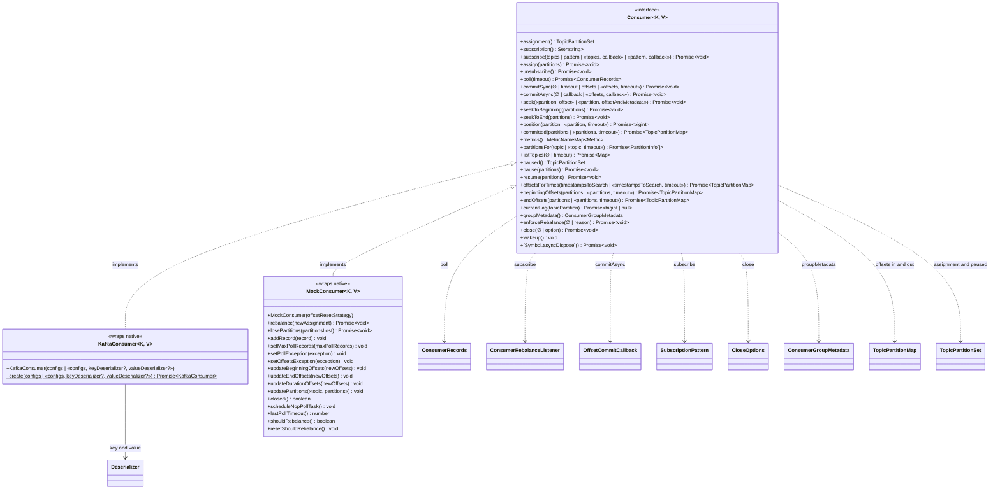
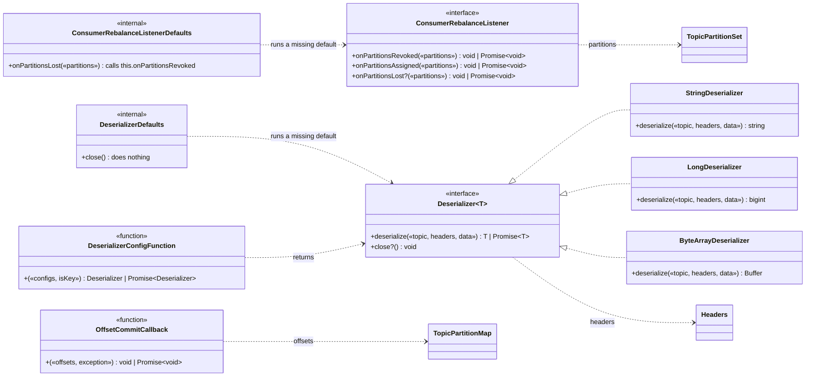
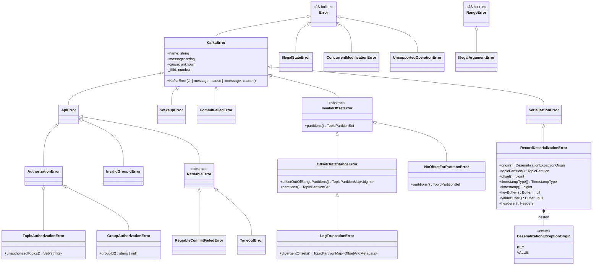
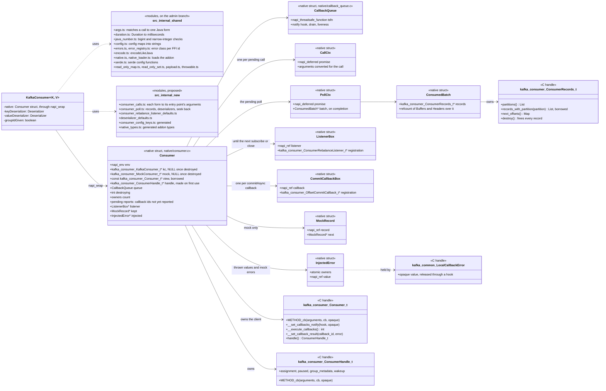

# JavaScript consumer: class diagram

*Draft for review, updated 2026-11-23 (first drawn 2026-11-10). This is a plan; none of it is built
yet.*

This page plans the classes of the JavaScript consumer: the ones users import, the binding's
internal helpers, and the native (C) layer under them. It follows these sources:

- the **JavaScript Binding Conventions** in `javascript/CLAUDE.md`, cited here as "the rules",
  with their question numbers (Q15, Q25, …). The conventions moved there from the root
  `CLAUDE.md` after the first draft;
- the Java source of Kafka 4.4 in `kafka/`, which decides names, parameters and behaviour;
- the consumer's C FFI in `rust/src/ffi/consumer/`, which decides which methods return a Promise;
- as precedent for the classes the consumer shares, the branches `dev/javascript-admin-client`
  ("the admin branch") and `dev/javascript-producer-bindings` ("the producer branch"). Their code
  predates the rule that makes the serdes Java's classes, so they still have a `stringSerializer()`
  factory where the rules now want `new StringSerializer()`.

Where the rules list a point under "Not decided yet", the diagrams show it as open instead of
picking an answer. §11 lists those points and the questions this plan still raises. `PLAN.md`
(2026-11-09) was written before the conventions and disagrees with them in places; §10 lists where.

**What changed since the 2026-11-10 draft**

- Types are decided: Java's `long` is `bigint`, and the returned collections are
  `TopicPartitionSet`, `Set<string>`, arrays, `Map`, `TopicPartitionMap` and `MetricNameMap`.
- Deserializers are Java's classes, built with `new` (`new StringDeserializer()`); the config keys
  take a function, `({ configs, isKey }) => deserializer`; and `KafkaConsumer.create()` waits for
  one that returns a Promise.
- `MockConsumer` wraps the FFI's mock instead of being a TypeScript translation of Java's.
- `Headers` and `Header` wrap native handles, and consumed keys and values are not copied.
- The binding keeps no closed flag and passes the core's busy message through unchanged. A
  consumer keeps Node running until `close()`.
- A missing `onPartitionsLost` runs a helper class with Java's default, instead of passing NULL to
  the FFI. Abstract classes are decided.
- The internals (§9) now follow the producer branch's native code.

## 1. A consumer in use

```js
import { KafkaConsumer } from '@confluentinc/kafka-javascript/consumer';
import { WakeupError } from '@confluentinc/kafka-javascript/common/errors';
import { StringDeserializer } from '@confluentinc/kafka-javascript/common/serialization';

const consumer = new KafkaConsumer({
  configs: { 'bootstrap.servers': 'localhost:9092', 'group.id': 'demo', 'group.protocol': 'consumer' },
  keyDeserializer: new StringDeserializer(),
  valueDeserializer: new StringDeserializer(),
});

try {
  await consumer.subscribe({
    topics: ['orders'],
    callback: {
      // The rebalance waits for this Promise. While it runs, the commit goes through the
      // core's ConsumerHandle, so it lands before the partitions move.
      async onPartitionsRevoked({ partitions }) { await consumer.commitSync(); },
      onPartitionsAssigned({ partitions }) {},
      // onPartitionsLost is left out: Java's default calls onPartitionsRevoked.
    },
  });
  process.once('SIGTERM', () => consumer.wakeup());
  for (;;) {
    const records = await consumer.poll(1000);   // a number is milliseconds
    for (const record of records) {              // ConsumerRecords is iterable
      // record.offset is a bigint, such as 42n
      console.log(record.topic, record.partition, record.offset, record.key, record.value);
    }
    await consumer.commitSync();
  }
} catch (e) {
  if (!(e instanceof WakeupError)) throw e;
} finally {
  await consumer.close();
}
```

When a deserializer has to be built asynchronously, such as one that fetches a schema first,
`create()` waits for it:

```js
const consumer = await KafkaConsumer.create({
  'bootstrap.servers': 'localhost:9092',
  'group.id': 'demo',
  'group.protocol': 'consumer',
  'key.deserializer': () => new StringDeserializer(),
  'value.deserializer': async ({ configs, isKey }) => loadValueDeserializer(configs, isKey),
});
```

`loadValueDeserializer` stands for the app's own code. What the Schema Registry deserializers
offer here is open (Q53, Q75).

## 2. How to read the diagrams

The diagrams are written in Mermaid, which GitHub and most IDE Markdown previews draw as
pictures.

**The label above a class name** says what kind of type it is:

| Label | Meaning |
|---|---|
| *(none)* | A plain TypeScript class whose values are read through methods: `timestamp.offset()`. |
| `interface` | A TypeScript interface: a type only, with no object at run time. |
| `data` | A data class: its values are public read-only fields, set when the object is built (`record.offset`), and the object is frozen. The rules list which classes are data classes. |
| `options` | An option class, built from one object of keys (`new CloseOptions({ timeout })`). |
| `enum` | A Java enum, drawn as a class with one frozen instance per constant. Every enum also has `name()`, `ordinal()`, `toString()`, `toJSON()` and the static `values()` and `valueOf()`, which the boxes leave out. |
| `abstract` | A Java abstract class. It is a TypeScript `abstract class`, so `tsc` refuses `new`, and in plain JavaScript its constructor throws `TypeError` when `new.target` is the class itself. |
| `wraps native` | A TypeScript class over a native handle, whose methods call the addon: the two consumers, `Headers` and `Header`. |
| `function` | A plain function type, such as a callback. |
| `js-only` | A JavaScript addition with no Java counterpart, on the rules' list of invented names. Its name is kept once released. |
| `internal` | Not exported. |
| `modules`, `native struct`, `C handle` | Internals only (§9). |

**Arrows:** `<|..` implements, `<|--` extends, `-->` holds, `..>` takes or returns.

**Call shapes.** Mermaid can't draw braces inside a box, so:

- `«a, b»` is one options object with the keys `a` and `b`: `seek(«partition, offset»)` means
  `seek({ partition, offset })`. A `?` after a key means the key can be left out.
- `x | y` lists the forms a method accepts, one per Java overload, and `∅` is the form with no
  argument: `commitSync(∅ | timeout | offsets | «offsets, timeout»)`.
- A one-parameter form takes the bare value or its options object: `poll(1000)` or
  `poll({ timeout: 1000 })`.
- A member marked `$` (drawn underlined) is static, `-` is private, and `~` is `@internal`, which
  `stripInternal` leaves out of the published type files.
- §5 lists every method's exact forms and C entry points.

**Types.**

- `Promise~T~` is TypeScript's `Promise<T>`: Mermaid writes `~` for angle brackets. A method
  returns a Promise exactly when its C entry point has a `_cb` twin; the others return directly.
  The one exception is the static `create()`.
- `Duration` is `number | Temporal.Duration`, where a number is milliseconds.
- `bigint` is Java's `long`. An argument also takes a whole `number`, and a `number` above 2^53
  throws `RangeError` instead of rounding. A returned value is always a `bigint`.
- An argument where Java takes a `Collection`, `List` or `Set` takes any iterable. A returned
  `Set<TopicPartition>` is a `TopicPartitionSet`, a `List` is an array, a `Set<String>` is a `Set`,
  and a map keyed by strings is a `Map`.
- Every value class also has Java's `equals`, `hashCode` and `toString`, and the value classes have
  `toJSON()` [ask c]. The boxes leave those four out.
- `[ask x]` points to question x in §11.2, which the rules don't cover. `[open Qnn]` points to an
  item the rules list as not decided.

## 3. Where each class lives

Each Java class is one file in its package's folder under `javascript/src/`, with `clients`
dropped from the package name. Users import from the package path, never from a file. The last
column says which classes already exist on a branch, as precedent the consumer reuses.

| Class | Kind | File in `javascript/src/` | Import from `@confluentinc/kafka-javascript/…` | On a branch |
|---|---|---|---|---|
| `Consumer<K, V>` | interface | `consumer/consumer.ts` | `consumer` | — |
| `KafkaConsumer<K, V>` | client; wraps native | `consumer/kafka_consumer.ts` | `consumer` | — |
| `MockConsumer<K, V>` | client; wraps the FFI's mock (Q62) | `consumer/mock_consumer.ts` | `consumer` | — |
| `ConsumerRecord<K, V>` | data | `consumer/consumer_record.ts` | `consumer` | — |
| `ConsumerRecords<K, V>` | methods | `consumer/consumer_records.ts` | `consumer` | — |
| `ConsumerRebalanceListener` | interface the user implements | `consumer/consumer_rebalance_listener.ts` | `consumer` | — |
| `OffsetCommitCallback` | function type | `consumer/offset_commit_callback.ts` | `consumer` | — |
| `OffsetAndMetadata` | data | `consumer/offset_and_metadata.ts` | `consumer` | admin |
| `OffsetAndTimestamp` | methods | `consumer/offset_and_timestamp.ts` | `consumer` | — |
| `ConsumerGroupMetadata` | methods; private constructor | `consumer/consumer_group_metadata.ts` | `consumer` | — |
| `CloseOptions` and its nested `GroupMembershipOperation` | options; enum | `consumer/close_options.ts` | `consumer` | — |
| `SubscriptionPattern` | methods | `consumer/subscription_pattern.ts` | `consumer` | — |
| `GroupProtocol` | enum | `consumer/group_protocol.ts` | `consumer` | — |
| `ConsumerConfig` | constants only | `consumer/consumer_config.ts` | `consumer` | — |
| Errors from Java's `consumer` package (`CommitFailedError`, `InvalidOffsetError`, `LogTruncationError`, `NoOffsetForPartitionError`, `OffsetOutOfRangeError`, `RetriableCommitFailedError`) | errors | `consumer/*_error.ts` | `consumer` | admin |
| `TopicPartition` | data | `common/topic_partition.ts` | `common` | admin |
| `TopicPartitionMap<V>`, `TopicPartitionSet` | js-only | `common/topic_partition_map.ts`, `common/topic_partition_set.ts` | `common` | admin |
| `MetricNameMap<V>` | js-only | `common/metric_name_map.ts` | `common` | admin |
| `PartitionInfo`; `Node` | methods; data | `common/partition_info.ts`, `common/node.ts` | `common` | admin |
| `MetricName`; `Metric` | methods; interface | `common/metric_name.ts`, `common/metric.ts` | `common` | admin |
| `KafkaError` | head of the error tree | `common/kafka_error.ts` | `common` | admin |
| Kafka's other errors (`WakeupError`, `RecordDeserializationError`, …) | errors | `common/errors/*.ts` | `common/errors` | admin |
| `TimestampType` | enum | `common/record/timestamp_type.ts` | `common/record` | admin |
| `Header`, `Headers` | wraps native | `common/header/header.ts`, `common/header/headers.ts` | `common/header` | admin |
| `Deserializer<T>` | interface the user implements | `common/serialization/deserializer.ts` | `common/serialization` | — |
| `StringDeserializer`, `ByteArrayDeserializer`, `ShortDeserializer`, `IntegerDeserializer`, `LongDeserializer`, `FloatDeserializer`, `DoubleDeserializer`, `BooleanDeserializer`, `UUIDDeserializer`, `VoidDeserializer` | classes | `common/serialization/string_deserializer.ts`, … | `common/serialization` | — |
| `Duration`; Java's built-in errors (`IllegalStateError`, `IllegalArgumentError`, `UnsupportedOperationError`, `ConcurrentModificationError`, `TimeoutError`) | type; errors | root files | the package root | admin |

Not exported: the hand-written helpers in `src/internal/`, the helper classes that hold Java's
`default` methods (`ConsumerRebalanceListenerDefaults`, `DeserializerDefaults`), the addon's
generated types, and the addon in `native/` (§9).

## 4. The consumer



Mermaid can't nest a union inside a generic, so the boxes shorten a few return types. §5 gives
them in full: `committed()` resolves to `TopicPartitionMap<OffsetAndMetadata | null>`,
`offsetsForTimes()` to `TopicPartitionMap<OffsetAndTimestamp | null>`, the two offsets methods to
`TopicPartitionMap<bigint>`, and `listTopics()` to `Map<string, PartitionInfo[]>`.

- **`Consumer<K, V>`** is a TypeScript interface, so code under test can take a `KafkaConsumer`
  or a `MockConsumer`. Java's `Closeable` becomes `close()` plus `[Symbol.asyncDispose]`, so
  `await using` closes a consumer where the runtime supports it. Java's `Consumer` has no static
  members, so there is no runtime object named `Consumer`.
- **`KafkaConsumer`** takes a bare config map, `new KafkaConsumer({ 'bootstrap.servers': … })`,
  or the options object `{ configs, keyDeserializer, valueDeserializer }`. A plain object is the
  options object when it has one of those keys, and a config map otherwise. A deserializer comes
  as a constructor argument or through its config key (§7); one given neither way means bytes, so
  `new KafkaConsumer(configs)` is a `KafkaConsumer<Buffer, Buffer>`.
- **`KafkaConsumer.create()`** *(js-only)* takes the constructor's arguments, awaits each
  deserializer config function in turn, the key's first, then builds the consumer as the
  constructor does. It makes no network call of its own. When a config function throws or rejects,
  `create()` rejects with `KafkaError('Failed to construct kafka consumer')`, whose `cause` is that
  error, and closes the deserializers already built. The constructor itself refuses a config
  function that returns a Promise, with a `ConfigError` that points to `create()`. The mock takes no
  deserializers, so it has no `create()`.
- **The preview warning.** Constructing a `KafkaConsumer` emits an `ExperimentalWarning` through
  `process.emitWarning`, once per process. The mock stays silent.
- **No closed flag.** A call after `close()` goes to the FFI, and the error is the core's, with
  Java's message: `IllegalStateError('This consumer has already been closed.')`. A synchronous
  method throws it, and a Promise method rejects with it. Four synchronous methods differ:
  `assignment()`, `subscription()`, `paused()` and `groupMetadata()` panic in the core, and the
  FFI's guard turns the panic into `IllegalStateError` whose message is prefixed with
  "Rust panic caught at the FFI boundary in kafka_consumer_Consumer_assignment: " [ask m]. A second
  `close()` is harmless.
- **One call at a time.** The binding keeps no lock. A second call while one is pending reaches
  the core, which fails it with `ConcurrentModificationError("KafkaConsumer is not safe for
  multi-threaded access.")`, passed through unchanged. `wakeup()`, `metrics()` and the calls made
  while a callback runs are exempt (§5, last column). `close()` during a pending `poll()` fails, as
  in Java, so the app calls `wakeup()`, lets its loop exit, and then awaits `close()`.
- **Node keeps running** from the moment a consumer is created until `close()` has closed it, so
  no pending `poll()` is cut off. A script that forgets `close()` doesn't exit on its own.
- **`MockConsumer`** wraps the FFI's `MockConsumer`, and its `Consumer` methods call the same entry
  points as `KafkaConsumer`'s, through the mock's `__as_Consumer` view, so they return the same
  Promises. `addRecord` passes the record's key and value to the FFI as `void *` references, so
  `poll()` returns the app's own objects; the binding holds them until the mock is destroyed. A
  method that Java's mock doesn't support fails with the core's `UnsupportedOperationError`. With no
  deserializers to infer the types from, the caller writes them:
  `new MockConsumer<string, string>('earliest')`. `rebalance` and `losePartitions` return
  Promises, because they run the listener and their entry points have `_cb` twins.
- **Left out**, and listed in the docs:
  - the `subscribe(Pattern …)` forms, which `SubscriptionPattern` replaces;
  - Java's deprecated `close(Duration)` and `MockConsumer(OffsetResetStrategy)`;
  - `clientInstanceId`, `registerMetricForSubscription` and `unregisterMetricFromSubscription`,
    which have no C entry point because the Rust core doesn't translate them yet;
  - the mock helpers with no C entry point: `schedulePollTask`, `disableTelemetry`,
    `injectTimeoutException`, `setClientInstanceId` and `addedMetrics`.

## 5. Every method: forms and C entry points

Every entry point below starts with `kafka_consumer_Consumer_`. A one-parameter form also accepts
its options object (`position({ partition })`). The last column says what happens to a call made
while a listener's or commit callback's report is pending: "handle" means it goes to the same
method on `kafka_consumer_ConsumerHandle_`, "refused" means it goes to the consumer, which is busy
with the call that ran the callback, so the core fails it with `ConcurrentModificationError`, and
"consumer itself" means it works as it does outside a callback.

| Method | Forms | Returns | Entry points | Inside a callback |
|---|---|---|---|---|
| `assignment` | `()` | `TopicPartitionSet` | `assignment` | handle |
| `subscription` | `()` | `Set<string>` | `subscription` | refused |
| `subscribe` | `(topics)`, `({ topics, callback })`, `(pattern)`, `({ pattern, callback })` | `Promise<void>` | `subscribe_with_topics_cb`, `subscribe_with_topics_listener_cb`, `subscribe_with_pattern_cb`, `subscribe_with_pattern_listener_cb` | refused |
| `assign` | `(partitions)` | `Promise<void>` | `assign_cb` | refused |
| `unsubscribe` | `()` | `Promise<void>` | `unsubscribe_cb` | refused |
| `poll` | `(timeout)` | `Promise<ConsumerRecords<K, V>>` | `poll_cb` | refused |
| `commitSync` | `()`, `(timeout)`, `(offsets)`, `({ offsets, timeout })` | `Promise<void>`, settled when the broker answers | `commit_sync_cb`, `commit_sync_with_timeout_cb`, `commit_sync_with_offsets_cb`, `commit_sync_with_offsets_timeout_cb` | handle |
| `commitAsync` | `()`, `(callback)`, `({ offsets, callback })` | `Promise<void>`, settled once the core has taken the commit | `commit_async_cb`, `commit_async_with_callback_cb`, `commit_async_with_offsets_callback_cb` | handle |
| `seek` | `({ partition, offset })`, `({ partition, offsetAndMetadata })` | `Promise<void>` | `seek_with_offset_cb`, `seek_with_offset_and_metadata_cb` | handle |
| `seekToBeginning`, `seekToEnd` | `(partitions)` | `Promise<void>` | `seek_to_beginning_cb`, `seek_to_end_cb` | handle |
| `position` | `(partition)`, `({ partition, timeout })` | `Promise<bigint>` | `position_cb`, `position_with_timeout_cb` | handle |
| `committed` | `(partitions)`, `({ partitions, timeout })` | `Promise<TopicPartitionMap<OffsetAndMetadata \| null>>` | `committed_cb`, `committed_with_timeout_cb` | handle |
| `metrics` | `()` | `MetricNameMap<Metric>` | `metrics` | consumer itself |
| `partitionsFor` | `(topic)`, `({ topic, timeout })` | `Promise<PartitionInfo[]>` | `partitions_for_cb`, `partitions_for_with_timeout_cb` | handle |
| `listTopics` | `()`, `(timeout)` | `Promise<Map<string, PartitionInfo[]>>` | `list_topics_cb`, `list_topics_with_timeout_cb` | handle |
| `paused` | `()` | `TopicPartitionSet` | `paused` | handle |
| `pause`, `resume` | `(partitions)` | `Promise<void>` | `pause_cb`, `resume_cb` | handle |
| `offsetsForTimes` | `(timestampsToSearch)`, `({ timestampsToSearch, timeout })` | `Promise<TopicPartitionMap<OffsetAndTimestamp \| null>>` | `offsets_for_times_cb`, `offsets_for_times_with_timeout_cb` | handle |
| `beginningOffsets`, `endOffsets` | `(partitions)`, `({ partitions, timeout })` | `Promise<TopicPartitionMap<bigint>>` | `beginning_offsets_cb`, `beginning_offsets_with_timeout_cb`, `end_offsets_cb`, `end_offsets_with_timeout_cb` | handle |
| `currentLag` | `(topicPartition)` | `Promise<bigint \| null>` [ask g] | `current_lag_cb` | handle |
| `groupMetadata` | `()` | `ConsumerGroupMetadata` | `group_metadata` | handle |
| `enforceRebalance` | `()`, `(reason)` | `Promise<void>` | `enforce_rebalance_cb`, `enforce_rebalance_with_reason_cb` | refused |
| `close` | `()`, `(option)` | `Promise<void>` | `close_cb`, `close_with_options_cb` | refused |
| `wakeup` | `()` | `void` | `wakeup` | consumer itself |
| `[Symbol.asyncDispose]` | `()` | `Promise<void>` | calls `close()` | refused |

- `pause` and `resume` return Promises, which may surprise KafkaJS users: Java's
  `AsyncKafkaConsumer` waits for its background thread to apply them (`PausePartitionsEvent`,
  `ResumePartitionsEvent`), so their entry points have `_cb` twins.
- From JavaScript the binding calls only `_cb` forms, accessors and constructors, never a blocking
  C function. A synchronous entry point is called through its `_err` twin, the only form
  `confluent_kafka_bindings.h` declares for it.
- Key names come from Java's `Consumer` interface, not its implementations: `subscribe`'s listener
  key is `callback`, as Java's interface names it.
- **Arguments.** An offset takes a `bigint` or a whole `number`. Partitions and topics take any
  iterable, and a bare string for `topics` throws
  `TypeError('topics must be an iterable of strings, not string')`. `commitSync({ offsets })`,
  `commitAsync({ offsets, callback })` and `offsetsForTimes` take only a `TopicPartitionMap`, and a
  plain `Map` throws `TypeError` with a hint.
- **Timeouts.** The binding doesn't check a negative timeout: it passes it to the FFI, whose
  `ms()` rejects it with `IllegalArgumentError("Timeout must not be negative")` for `poll`,
  `commitSync`, `position`, `committed`, `partitionsFor`, `listTopics`, `beginningOffsets`,
  `endOffsets` and `offsetsForTimes`, the `ConsumerHandle` forms included (a deviation: Java says
  "Invalid negative timeout -1" from the first three). A negative `CloseOptions` timeout is read as
  zero (a deviation: Java throws). `null` fails with `TypeError('timeout must not be null')`, except
  in `CloseOptions`. `NaN` or a finite number above `Number.MAX_SAFE_INTEGER` fails with
  `RangeError`, fractions are rounded down, `Infinity` is sent as Java's `Long.MAX_VALUE`, and a
  `Temporal.Duration` with years, months or weeks fails with `RangeError`.
- **The one check the binding makes.** `groupMetadata()` and `committed(null)` without `group.id`
  throw `InvalidGroupIdError` with Java's message (temporary: the core checks with a panic). The
  binding has no closed flag, so on a closed consumer without `group.id` this check wins, where Java
  reports the closed consumer first [ask m].
- **Inside a callback.** The rules name `poll`, `subscribe`, `assign` and `close` as refused. The
  `ConsumerHandle` has no form of `subscription`, `unsubscribe` or `enforceRebalance` either, so
  they go to the consumer and are refused the same way, as in Python.

## 6. Records and values

```mermaid
classDiagram
    direction TB

    class ConsumerRecord~K, V~ {
        <<data>>
        +NO_TIMESTAMP: bigint$
        +NULL_SIZE: number$
        +ConsumerRecord(«5 keys» | «11 keys» | «12 keys»)
        +topic: string
        +partition: number
        +offset: bigint
        +timestamp: bigint
        +timestampType: TimestampType
        +serializedKeySize: number
        +serializedValueSize: number
        +key: K | null
        +value: V | null
        +headers: Headers
        +leaderEpoch: number | null
        +deliveryCount: number | null
    }

    class ConsumerRecords~K, V~ {
        +EMPTY: ConsumerRecords$
        +empty() ConsumerRecords$
        +ConsumerRecords(«records, nextOffsets») [ask b]
        +records(partition) ConsumerRecord[]
        +records(topic) Iterable~ConsumerRecord~
        +nextOffsets() TopicPartitionMap~OffsetAndMetadata~
        +partitions() TopicPartitionSet
        +count() number
        +isEmpty() boolean
        +[Symbol.iterator]() Iterator~ConsumerRecord~
    }

    class TopicPartition {
        <<data>>
        +TopicPartition(«topic, partition»)
        +topic: string | null
        +partition: number
    }

    class TopicPartitionMap~V~ {
        <<js-only>>
        +TopicPartitionMap(∅ | entries)
        +get(partition) V | undefined
        +has(partition) boolean
        +set(partition, value) TopicPartitionMap
        +delete(partition) boolean
        +clear() void
        +size() number
        +keys() Iterator~TopicPartition~
        +values() Iterator~V~
        +entries() Iterator~Entry~
        +forEach(callback) void
        +[Symbol.iterator]() Iterator~Entry~
    }

    class TopicPartitionSet {
        <<js-only>>
        +add(partition) TopicPartitionSet
        +has(partition) boolean
        +delete(partition) boolean
        +clear() void
        +size() number
        +values() Iterator~TopicPartition~
        +forEach(callback) void
        +[Symbol.iterator]() Iterator~TopicPartition~
    }

    class MetricNameMap~V~ {
        <<js-only>>
        +get(metricName) V | null
        +has(metricName) boolean
        +size() number
        +keys() Iterator~MetricName~
        +values() Iterator~V~
        +entries() Iterator~Entry~
        +forEach(callback) void
        +[Symbol.iterator]() Iterator~Entry~
    }

    class OffsetAndMetadata {
        <<data>>
        +OffsetAndMetadata(offset | «offset, metadata» | «offset, leaderEpoch, metadata»)
        +offset: bigint
        +metadata: string
        +leaderEpoch: number | null
    }

    class OffsetAndTimestamp {
        +OffsetAndTimestamp(«offset, timestamp» | «offset, timestamp, leaderEpoch»)
        +offset() bigint
        +timestamp() bigint
        +leaderEpoch() number | null
    }

    class ConsumerGroupMetadata {
        -ConsumerGroupMetadata()
        ~internalCreate(groupId, generationId, memberId, groupInstanceId) ConsumerGroupMetadata$
        +groupId() string
        +generationId() number
        +memberId() string
        +groupInstanceId() string | null
    }

    class CloseOptions {
        <<options>>
        -CloseOptions(«operation?, timeout?»)
        +timeout(timeout) CloseOptions$
        +groupMembershipOperation(operation) CloseOptions$
        +withTimeout(timeout) CloseOptions
        +withGroupMembershipOperation(operation) CloseOptions
        +groupMembershipOperation() GroupMembershipOperation
        +timeout() number | null
    }

    class GroupMembershipOperation {
        <<enum>>
        LEAVE_GROUP
        REMAIN_IN_GROUP
        DEFAULT
    }

    class SubscriptionPattern {
        +SubscriptionPattern(pattern)
        +pattern() string
    }

    class TimestampType {
        <<enum>>
        NO_TIMESTAMP_TYPE
        CREATE_TIME
        LOG_APPEND_TIME
        +id: number
        +forName(name) TimestampType$
    }

    class GroupProtocol {
        <<enum>>
        CLASSIC
        CONSUMER
        +of(name) GroupProtocol$
    }

    class PartitionInfo {
        +PartitionInfo(«5 keys» | «6 keys»)
        +topic() string | null
        +partition() number
        +leader() Node | null
        +replicas() Node[]
        +inSyncReplicas() Node[]
        +offlineReplicas() Node[]
    }

    class Node {
        <<data>>
        +Node(«id, host, port» | «id, host, port, rack» | «id, host, port, rack, isFenced»)
        +noNode() Node$
        +id: number
        +idString: string
        +host: string | null
        +port: number
        +rack: string | null
        +hasRack: boolean
        +isEmpty: boolean
        +isFenced: boolean
    }

    class Headers {
        <<wraps native>>
        +Headers(∅ | headers)
        +add(header | «key, value») Headers
        +remove(key) Headers
        +lastHeader(key) Header | null
        +headers(key) Iterable~Header~
        +toArray() Header[]
        +[Symbol.iterator]() Iterator~Header~
    }

    class Header {
        <<wraps native>>
        +Header(«key, value»)
        +key() string
        +value() Buffer | null
    }

    class MetricName {
        +MetricName(«name, group, description, tags»)
        +name() string
        +group() string
        +description() string
        +tags() Map~string, string~
    }

    class Metric {
        <<interface>>
        +metricName() MetricName
        +metricValue() unknown
    }

    ConsumerRecords o-- ConsumerRecord : records
    ConsumerRecords --> TopicPartitionMap : nextOffsets
    ConsumerRecords ..> TopicPartitionSet : partitions
    ConsumerRecord --> TimestampType
    ConsumerRecord --> Headers
    Headers o-- Header
    TopicPartitionMap o-- TopicPartition : keys
    TopicPartitionSet o-- TopicPartition
    TopicPartitionMap ..> OffsetAndMetadata : values
    MetricNameMap o-- MetricName : keys
    CloseOptions *-- GroupMembershipOperation : nested
    PartitionInfo --> Node : leader and replicas
    Metric --> MetricName
```



- **Data classes.** The rules' list is: the records, `TopicPartition`, `OffsetAndMetadata`,
  `RecordMetadata`, `Node` and the admin description classes. On those, each Java method that takes
  no argument and returns a value becomes a public read-only field (`record.offset`, `tp.topic`),
  and the constructor ends with `Object.freeze(this)`. So `Node`'s `hasRack`, `isEmpty` and
  `isFenced` are fields too, as the admin branch has them.
- **Everything else keeps methods**, including `ConsumerRecords` (`records.count()`,
  `records.nextOffsets()`), which isn't on the list. There are no getter properties.
- **Java's `equals`, `hashCode` and `toString`** are on every value class, as on the admin branch,
  where `equals` takes the other object bare or as `{ obj }`. `console.log(tp)` prints the fields;
  `` `${tp}` `` gives Java's format, such as `orders-3`. A `[util.inspect.custom]` that prints
  Java's format is a future improvement in the rules.
- **`TopicPartitionMap<V>`** replaces Java's `Map<TopicPartition, V>`, as input and as output. It
  wraps a `Map` keyed by strings such as `'orders:3'` (a topic name can't contain `:`) and keeps
  each original `TopicPartition`, so `keys()` and `entries()` return them. It doesn't extend `Map`,
  so `instanceof Map` is false. **`TopicPartitionSet`** is its set form, returned where Java
  returns a `Set<TopicPartition>`. **`MetricNameMap<V>`** is built the same way, keyed by what
  Java's `MetricName.equals` compares (the group, the name and the tags), and it is read-only.
  `Entry` stands for a pair of a key and a value. The members drawn are the admin branch's.
- **Returned collections** are new objects the caller may change. Constants are frozen.
- **Constructors with several Java forms** take one options object whose keys must match one form
  exactly, and nothing is filled in. The 5-key `ConsumerRecord` form is
  `{ topic, partition, offset, key, value }`; the 11-key form adds `timestamp`, `timestampType`,
  `serializedKeySize`, `serializedValueSize`, `headers` and `leaderEpoch`; the 12-key form adds
  `deliveryCount`. `PartitionInfo` has `{ topic, partition, leader, replicas, inSyncReplicas }` and
  the same plus `offlineReplicas`.
- **Single-form constructors with several parameters** (`TopicPartition`, `MetricName`) take one
  options object on the admin branch, so this plan does the same for `ConsumerRecords` and
  `MockConsumer.updatePartitions`. The rules don't say [ask b].
- **`ConsumerGroupMetadata`** is a plain TypeScript class. Java deprecated every constructor, so
  the TypeScript constructor is private and the binding builds the object through the `@internal`
  factory `internalCreate`. `groupMetadata()` reads the four values from the core's handle, then
  destroys the handle.
- **`CloseOptions`** has a private constructor in Java, so it is built with Java's static factories,
  `CloseOptions.timeout(t)` and `CloseOptions.groupMembershipOperation(op)`, and the `with…` setters.
  A `null` timeout is allowed here and means the default. The nested enum is reached as
  `CloseOptions.GroupMembershipOperation.LEAVE_GROUP`. `timeout()` returns Java's
  `Optional<Duration>` as a number of milliseconds or `null`.
- **Enums.** By the rules, `toString()` and `toJSON()` return the constant's name. Java's
  `TimestampType.toString()` returns `"CreateTime"`, and the admin branch keeps that. Java's
  `TimestampType` and `GroupProtocol` also have a public field `name` that collides with the
  `name()` every enum gets; the admin branch drops the field [ask a].
- **Consumed bytes are not copied.** A key or value from `poll()` is a `Buffer` over the record's
  bytes in the core's fetch buffer, made with `napi_create_external_arraybuffer`. The FFI frees the
  records of a poll only all at once, with `kafka_consumer_ConsumerRecords_destroy`, so the binding
  keeps the poll's whole `ConsumerRecords` handle alive until every `Buffer` and `Headers` over any
  of its records has been garbage collected. Where the runtime refuses external buffers
  (`napi_no_external_buffers_allowed`, as Electron does), the binding copies the bytes instead. The
  binding doesn't call `napi_adjust_external_memory`. The docs say that a value you keep holds the
  whole fetch in memory, and to copy it with `Buffer.from(value)`.
- **`Headers` and `Header`** wrap native handles. A consumed record's `Headers` wraps the view that
  `kafka_consumer_ConsumerRecord_headers` lends out, so it keeps the poll's handle alive too, and
  its `Header` values are `Buffer`s over the same bytes. Whether a consumed `Headers` can be changed,
  and how a `Header` from a `Headers` that can still change stays valid, are open [open Q31].
- **`toJSON()`** *(js-only)* writes a `bigint` as a decimal string. The rules put it on "value
  classes" without a list; the admin branch has it on many classes but not on `MetricName` [ask c].

## 7. Callbacks and deserializers



- **Listener methods** each take one object, `onPartitionsRevoked({ partitions })`, where
  `partitions` is a `TopicPartitionSet` (Java passes a `SortedSet`). A method may return a Promise,
  and the rebalance waits until it settles. `onPartitionsRevoked` and `onPartitionsAssigned` are
  required; `onPartitionsLost` is optional.
- **Java's `default` methods.** When the user's listener lacks `onPartitionsLost`, the binding runs
  `ConsumerRebalanceListenerDefaults.onPartitionsLost` with the user's object as `this`, so it calls
  the user's `onPartitionsRevoked`, as in Java. The binding checks for the method on each call and
  keeps no state, and it always gives the FFI a function for a `default` method, never NULL. A
  missing required method is passed as NULL to `kafka_consumer_ConsumerRebalanceListener_new_err`,
  and the FFI's `LocalNullPointerError` ("on_partitions_revoked must not be null") becomes a
  `TypeError`. The helper classes live in `src/internal/` and aren't exported in the preview.
- **`OffsetCommitCallback`** is a plain function, `({ offsets, exception }) => void | Promise<void>`.
  `offsets` is a `TopicPartitionMap<OffsetAndMetadata>`, and can be `null` on failure; `exception`
  is `null` on success, and its type is drawn as `Error | null` [ask g]. `commitAsync`'s Promise
  settles once the core has taken the commit; the callback runs later, inside a waiting call
  (`poll`, a commit, `close`).
- **When a callback fails.** A rejection, or a throw before the callback returns, crosses the core
  as a `LocalCallbackError` that holds the thrown value. The consumer call that ran the callback
  (`poll`, a commit, `close`) fails with it, wrapped where Java wraps it, and the thrown value comes
  back as itself. No rejection is left unhandled.
- **No callback timeout.** A callback that never settles blocks the call that ran it, as in Java,
  and `wakeup()` doesn't end it. The docs say so.
- **`Deserializer<T>`** is one object whose single `deserialize` stands for Java's three overloads.
  It may return a Promise, which the binding awaits (whether serde methods become always async is
  open, Q50). It is never called for a null key or value: the record's field is `null`, as in Java.
  A missing `close()` runs `DeserializerDefaults.close()`, which does nothing. There is no
  `configure()`.
- **The built-in deserializers** are Java's classes, built with `new`: `String`, `ByteArray`,
  `Short`, `Integer`, `Long`, `Float`, `Double`, `Boolean`, `UUID` and `Void`, each with
  `Deserializer` appended. They match Java byte for byte and keep Java's messages.
  `LongDeserializer` returns a `bigint`, `ByteArrayDeserializer` the `Buffer` it's given (over the
  fetched bytes), `UUIDDeserializer` a string in the canonical form, and `VoidDeserializer` `null`.
  `StringDeserializer` reads UTF-8 only. Java's `ByteBuffer`, `Bytes` and `List` deserializers are
  left out.
- **Two ways to give a deserializer.** As a constructor argument (`keyDeserializer`,
  `valueDeserializer`), or through the config keys `key.deserializer` and `value.deserializer`,
  which take a function, `({ configs, isKey }) => deserializer`, called once with the whole config.
  A constructor argument wins, and its config key is then ignored. A class name, a deserializer
  object or a class in a config key throws `ConfigError`, the class with the hint "did you mean
  `() => new StringDeserializer()`?". A function given as a constructor argument throws `TypeError`
  with "did you forget `new`?". The config object the function receives records the keys it reads,
  and the binding leaves those keys out of the config it sends to the core.
- **The core gets no deserializers** (NULL), and the binding runs them in JavaScript inside
  `poll()`. When one fails, `poll()` rejects with `RecordDeserializationError`, and the binding
  seeks back, so the next `poll()` returns the failed record again (a deviation, as in Python: the
  core has already moved past the whole batch).

## 8. Errors



- **One generated class per error id** in the FFI's `kafka_common_Error_e`, with Java's `extends`
  chain. The diagram shows the errors consumer users meet most. Classes from Java's `consumer`
  package (`CommitFailedError`, `RetriableCommitFailedError`, `InvalidOffsetError` and its
  subclasses) import from `…/consumer`, the others from `…/common/errors`, and Java's built-ins
  from the root. Most of them already exist on the admin branch.
- **Abstract errors.** `RetriableError` and `InvalidOffsetError` (and `InvalidMetadataError`, not
  drawn) are abstract in Java. They are TypeScript abstract classes for catching only, with no FFI
  id; constructing one throws `TypeError`.
- **The class is the check:** `e instanceof CommitFailedError`. There is no `code` and no `is*()`;
  `name` is the class name, and `_ffiId` is private.
- **Constructors** take `()`, a string (the message), an `Error` (the cause), or one object with
  `message`, `cause` and Java's other parameters by name, as in
  `new TopicAuthorizationError({ message, unauthorizedTopics })`. A second argument throws
  `IllegalArgumentError`. Messages from the core pass through unchanged.
- **Payload getters are methods**, filled from the FFI's payload views for an error from the core.
  `keyBuffer()` and `valueBuffer()` return Java's `ByteBuffer` as `Buffer | null` [ask g].
- **A null where Java forbids one** fails with JavaScript's own `TypeError`; there is no
  `NullPointerError`.
- **A panic the core catches** reaches the user unchanged, as `IllegalStateError`, and the docs
  say to close that client and create a new one (Q35).
- **Two names exist twice:** `OffsetOutOfRangeError` (Java's `consumer` and `common.errors`
  packages) and `TimeoutError` (the root's, Java's `java.util.concurrent` one, and Kafka's in
  `common/errors`). The diagram shows the consumer's `OffsetOutOfRangeError` and Kafka's
  `TimeoutError`, which the consumer's calls raise. Neither `TimeoutError` is the `DOMException`
  that `AbortSignal.timeout()` throws.

## 9. Internals

The rules fix the folders (`src/internal/` for hand-written TypeScript helpers and generated addon
types, `native/` for the addon) but not every file or struct. The shared files below exist on the
admin branch, and the native layer follows the producer branch's `native/producer.c`. The new
names are proposals.



- **One struct for both consumers.** As the producer branch does for `KafkaProducer` and
  `MockProducer`, one `Consumer` struct holds either a `KafkaConsumer` handle or a `MockConsumer`
  handle, plus the borrowed `__as_Consumer` view that every `Consumer` method calls.
- **A Promise method** matches the call to one Java form first (`args.ts`), then converts the
  arguments by the rules' FFI table (a `TopicPartition` as its topic and partition, a `Duration` as
  milliseconds, a `TopicPartitionMap` as a list of pairs), then calls the `_cb` twin with a
  `CallCtx`. The completion settles the Promise. Besides the form, the binding makes only the
  `group.id` check (§5) and the run-time type checks TypeScript can't enforce.
- **Waking the JavaScript thread.** The core's notify hook only signals the consumer's one
  threadsafe function (tsfn: Node-API's way for another thread to schedule work on the JavaScript
  thread). The binding then drains `__execute_callbacks` on the JavaScript thread, which runs
  completions, listener methods and commit callbacks. The binding adds no thread of its own. This is
  the producer branch's `callback_queue.c`, shared.
- **Reporting callbacks.** The core gives each listener or commit-callback call a `callback_id`.
  The binding reports it exactly once, through `__set_callback_result`, when the callback returns
  or its Promise settles. The struct keeps the ids not yet reported. A thrown value becomes a
  `LocalCallbackError` that holds a Node-API reference to it, released through an `InjectedError`
  with an owner count, as the producer branch does; this replaces the first draft's locked release
  queue.
- **Calls made during a callback.** While a report is pending, `native/consumer.c` sends each
  `ConsumerHandle` method to the handle's `_cb` form (or its accessor) and every other method to the
  consumer, where the core refuses it as busy (§5, last column). The pending report alone decides;
  there is no `AsyncLocalStorage` mark (a future improvement in the rules, Q46).
- **Poll.** The completion delivers a `kafka_consumer_ConsumerRecords_t`, which a `ConsumedBatch`
  takes over. `consumer_poll.ts` reads the partitions and records, wraps each key, value and
  `Headers` view over the batch, runs the deserializers (awaiting any Promise), builds each
  `ConsumerRecord` through its public constructor, and reads `nextOffsets` from the core. The batch
  is destroyed once its last `Buffer` or `Headers` is garbage collected; on Electron the bytes are
  copied and the batch is destroyed at once. For a `MockConsumer`, the keys and values are the
  app's own objects, read back from their references, and no deserializer runs. When a deserializer
  fails, the binding seeks each partition back to its first record not returned, then rejects.
- **Lifetime and closing.** There is no closed flag and no finalizer that closes. `close()` calls
  `close_cb` or `close_with_options_cb`; on completion the binding releases the listener and
  callback registrations on the JavaScript thread, makes the addon's reference to the JavaScript
  object weak, and calls `napi_unref_threadsafe_function` [ask j]. The Node-API finalizer destroys
  only a closed consumer: first the `ConsumerHandle`, then the client, whose destroy runs any queued
  report itself, exactly once. The binding never destroys a consumer while a report is pending, and
  never reports after destroying one. A consumer that is never closed keeps Node running until the
  process exits, with a warning whose timing is open [open Q21].

## 10. Where PLAN.md disagrees with the rules

1. **Layout.** PLAN puts C in `javascript/src/*.c` (`consumer.c`, `consumer_callbacks.c`) and
   TypeScript in `lib/`, with `_`-prefixed private files (`_poll.ts`, `_routing.ts`,
   `_subscription_state.ts`). The rules: TypeScript in `src/` (one folder per Java package), helpers
   in `src/internal/`, the addon in `native/`, output in `dist/`, and no `_` prefix, because
   `exports` lists only the package paths.
2. **Getters.** PLAN makes every Java getter a read-only property (`records.count`,
   `records.nextOffsets`). The rules: fields only on the listed data classes, methods everywhere
   else (`records.count()`), and no getter properties.
3. **Overloads and timeouts.** PLAN uses a trailing `timeoutMs?` (`position(partition, timeoutMs?)`)
   and `close(options?)`. The rules: two-parameter forms take one options object
   (`position({ partition, timeout })`), the key is `timeout`, typed `Duration`, `Infinity` means no
   limit, `null` fails with `TypeError('timeout must not be null')`, and a negative timeout goes to
   the FFI unchecked.
4. **Listeners and the commit callback.** PLAN passes positional arguments
   (`onPartitionsRevoked(partitions)`, `callback(offsets, error)`). The rules: one object
   (`onPartitionsRevoked({ partitions })`, `({ offsets, exception }) => …`), and a missing
   `onPartitionsLost` runs `ConsumerRebalanceListenerDefaults`, never NULL.
5. **Deserializers (C2).** PLAN: a synchronous `deserialize(topic, data, headers)` with `configure?`,
   config keys that accept Java class names, an async deserializer refused, and a positional
   constructor `new KafkaConsumer(configs, keyDeserializer, valueDeserializer)`. The rules:
   `deserialize({ topic, headers, data })`, which may return a Promise; no `configure()`; config
   keys that take `({ configs, isKey }) => deserializer`; constructor keys `keyDeserializer` and
   `valueDeserializer`; and `KafkaConsumer.create()`. Both agree on Java's classes built with `new`.
6. **Maps keyed by `TopicPartition` (C10).** PLAN keys a JavaScript `Map` by object identity. The
   rules: `TopicPartitionMap<V>` and `TopicPartitionSet`, matched by value, and `MetricNameMap<V>`
   for `metrics()`.
7. **`long` and collections.** PLAN decides `number`. The rules: `bigint`, any iterable as input,
   and `TopicPartitionSet`, `Set`, arrays and `Map` as output.
8. **Received bytes (C3).** PLAN copies once per poll into an arena. The rules: no copy, external
   `Buffer`s over the core's memory, and a copy only where the runtime refuses external buffers.
9. **Calls made inside a callback (C5).** PLAN decides `AsyncLocalStorage`. The rules: the pending
   report alone routes calls to the `ConsumerHandle`, and `AsyncLocalStorage` is a future
   improvement (Q46).
10. **Closed state.** PLAN tracks a state of open, closing, closed or finalizing. The rules: no
    closed flag; the core reports a closed consumer.
11. **Garbage collection (C8) and the ledger (rule 13).** PLAN adds a finalizer that reports the
    pending ledger and closes the consumer on a detached thread. The rules: the finalizer only
    destroys a consumer that's already closed, whose destroy runs any queued report itself; a
    consumer that's never closed runs until the process exits, with a warning.
12. **Keeping Node alive (rule 19).** PLAN unrefs an idle consumer so the process can exit. The
    rules: a consumer keeps Node running until `close()`.
13. **`MockConsumer` (C7).** PLAN: a pure TypeScript translation of Java's mock, with the FFI's mock
    serving only native tests. The rules: the mock wraps the FFI's mock (Q62).
14. **Errors.** Phase 1's errors have `code` and `errorName` properties. The rules: no `code`, no
    `is*()`, a private `_ffiId`, constructors taking `{ message, cause, … }`, abstract bases for
    catching only, and `IllegalArgumentError` and `IndexOutOfBoundsError` extending `RangeError`.
15. **Additions PLAN lacks:** `[Symbol.asyncDispose]`, `toJSON()` on value classes,
    `KafkaConsumer.create()`, `TopicPartitionSet`, `MetricNameMap`, one `ExperimentalWarning` per
    process, and Promise methods that reject instead of throwing.

They now agree on: the overlapping-call error passed through unchanged (C6), `ConsumerConfig` as
constants only, unknown config keys going to the core, and payload getters on errors (C9).

PLAN.md §4.1, §4.3 and decisions C1–C10 need updating to match. That is not done yet.

## 11. Open questions

### 11.1 Items the rules list as not decided

| Item | Where this plan meets it |
|---|---|
| Headers as plain `[key, value]` pairs on a record (Q31, Q60) | `ConsumerRecord`'s 11- and 12-key constructors, and so `MockConsumer.addRecord` |
| Whether a consumed record's `Headers` can be changed (Q31) | `ConsumerRecord.headers`, the deserializer's `headers` |
| How a `Header` from a `Headers` that can still change stays valid (Q31) | records the app builds for the mock |
| An existing method that starts to wait (Q42, case 3) | `assignment`, `subscription`, `paused`, `groupMetadata`, `metrics`, if their entry points gain a `_cb` twin later |
| When and how the never-closed warning is logged (Q21) | `KafkaConsumer`, and whether `MockConsumer` warns too |
| Whether serde methods are all async (Q50) | `Deserializer<T>` |
| The Schema Registry functions for the serde config keys (Q53, Q75) | `create()`, the second example in §1 |
| The other `tsc` settings (Q74) | the examples' top-level `await`, the `.d.ts` files |
| Schema Registry's release and source location (Q75) | nothing in the consumer itself |

### 11.2 Questions this plan raises

These are the questions still open. Of the first draft's questions, d, e, h and i are now answered
by the rules or the branches, and f is answered here:

- d: `ConsumerGroupMetadata` holds plain values; `groupMetadata()` reads the core's handle and
  destroys it.
- e: the mock's `rebalance` and `losePartitions` return Promises, since their entry points have
  `_cb` twins.
- h: `TopicPartitionMap`, `TopicPartitionSet` and `MetricNameMap` live in `common`, with the admin
  branch's members, and the deserializers are classes in `common/serialization`.
- i: moot, since the mock wraps the FFI and no Java internals are translated.
- f: this plan keeps `enforceRebalance`, `shouldRebalance` and `resetShouldRebalance`. Python drops
  them, but the rules don't repeat that drop, and the FFI has entry points for all three. Say if
  you'd rather drop them.

a. **Enums.** The rules say an enum's `toString()` and `toJSON()` return the constant's name, but
   another rule keeps Java's `toString()` format, and Java's `TimestampType.toString()` returns
   `"CreateTime"`, which the admin branch keeps. Also, `TimestampType` and `GroupProtocol` have a
   public Java field `name` (`"CreateTime"`, `"consumer"`) that collides with the `name()` method
   every enum gets; the admin branch drops the field. Which `toString()` wins, and is dropping the
   field right?

b. **Single-form calls with several parameters.** `TopicPartition`, `ConsumerRecords`,
   `MetricName` and `MockConsumer.updatePartitions` have one Java form each. The admin branch takes
   one options object for them (`new TopicPartition({ topic, partition })`), and this plan follows
   it. The rules don't say. Should that go into the rules?

c. **Which classes get `toJSON()`.** The rules put it on "value classes", whose output is frozen once
   released, without a list. The admin branch has it on many classes but not on `MetricName`. Is the
   list the data classes, every class with Java's `equals`, or something else?

g. **Java types with no row in the Types table.** The rules say a missing row stops generation.
   This plan draws `OptionalLong` (`currentLag`) as `bigint | null`, `ByteBuffer`
   (`RecordDeserializationError.keyBuffer()`) as `Buffer | null`, and `Exception` (the commit
   callback's `exception`) as `Error | null`. Are those the rows to add?

j. **Keeping Node running after `close()`.** The rules say `close()` unrefs the threadsafe function,
   "so nothing is counted". The producer branch instead keeps it referenced while a `_cb` call is
   still pending after `close()`, so the answer to a late call isn't cut off. Which does the
   consumer follow?

k. **A mock that is never closed.** If `MockConsumer` keeps Node running like `KafkaConsumer`, a
   test that forgets `close()` keeps Jest from exiting. Should the mock keep Node running?

l. **`*Args` type names.** The rules list "the `*Args` option types" as invented names, but neither
   branch exports any; the options types are written inline. Should the consumer export types such
   as `CommitSyncArgs`, and what is the naming pattern?

m. **Closed consumer, synchronous getters.** The rules say it isn't checked yet whether the FFI
   turns the core's panic into `IllegalStateError` (Q61). It does, but the message is
   "Rust panic caught at the FFI boundary in kafka_consumer_Consumer_assignment: This consumer has
   already been closed." for `assignment`, `subscription`, `paused` and `groupMetadata`, and for the
   handle's `assignment`, `paused` and `group_metadata`. Q35's advice to close the client and create
   a new one reads oddly here, since the client is already closed. Should the FFI return the plain
   error (an FFI change, outside the JavaScript work), or should the docs explain the prefix? A
   related point: with no closed flag, `groupMetadata()` on a closed consumer without `group.id`
   throws `InvalidGroupIdError` from the binding, where Java reports the closed consumer.

n. **`Header` or `RecordHeader`.** The rules call the class the app builds a `RecordHeader` in one
   place and `Header` in another. Java's `RecordHeader` is internal, and the admin branch exports a
   class named `Header`. Is `Header` the public name?
